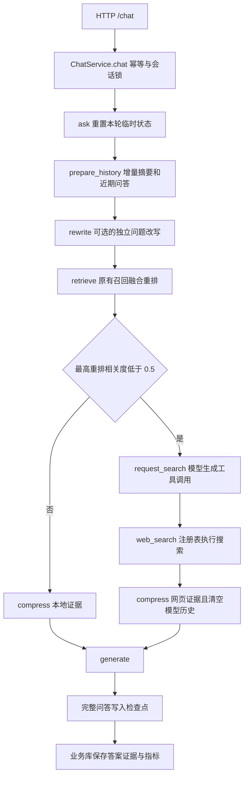

# PaperAgent 上下文压缩与代码阅读

## 1. 本次实现

本次新增证据去重、预算内的相关句抽取、历史增量摘要和完整近期问答保留。FastAPI 问答入口和默认命令行入口都已接入。PDF 上传、切块、Embedding、Chroma 检索、BM25、RRF、Cross-Encoder 和既有的联网回退流程继续复用。

历史原文由 LangGraph Checkpointer 完整保存，界面仍可查看全部问答。模型每轮接收旧历史摘要、近期完整问答和本轮检索证据。

联网回答使用改写后的独立问题和当前网页证据。生成答案时，历史摘要和历史消息均被排除。独立问题的改写过程仍会使用历史来消解指代。

## 2. 按这个顺序阅读代码

以下路径均相对于桌面的 `langgraph` 项目目录。

| 文件 | 职责 | 建议先读的函数 |
| --- | --- | --- |
| `pdfprocess/context_compression.py` | 预算配置、估算、历史摘要、句子去重和抽取 | `CompressionConfig`、`summarize_history`、`compress_evidence` |
| `pdfprocess/rag.py` | 组装模型与检索依赖，连接 LangGraph 节点 | `ask`、`build_graph` |
| `pdfprocess/rag_state.py` | 定义完整历史、摘要及本轮结果字段 | `RAGState` |
| `pdfprocess/rag_nodes.py` | 执行历史整理、检索、证据压缩与答案生成 | `prepare_history_node`、`compress_node`、`generate_node` |
| `pdfprocess/rag_prompts.py` | 定义本地答案与问题改写提示词 | `prompt`、`rewrite_prompt` |
| `upload_service/chat.py` | 将真实模型、检索器和 SQLite Checkpointer 接入 HTTP 服务 | `chat`、`_graph`、`_checkpoint_result` |
| `pdfprocess/retrieval.py` | Dense/BM25 召回、RRF 融合和重排 | `PaperRetriever.search`、`reciprocal_rank_fusion`、`rerank` |
| `pdfprocess/embeddings.py` | 对文档及问题调用同一个 Embedding 模型 | `embed_documents`、`embed_query` |
| `pdfprocess/cross_encoder.py` | 本地 ONNX 模型加载、文本对编码及重排分数计算 | `_load`、`score` |
| `pdfprocess/web_search.py` | Bing RSS 搜索、响应检查与清理 | `web_search`、`BingWebSearch.search`、`clean_results` |
| `upload_service/benchmark_chat.py` | 使用公开接口进行多轮测试，并累计摘要、改写和答案 Token | `run_chat_benchmark` |
| `tests/test_context_compression.py` | 压缩规则及图状态回归测试 | 按测试名称阅读输入和断言 |
| `tests/test_compression_service.py` | 正常服务入口、重启、重试、预算错误和成本统计测试 | `test_normal_entry_persists_summary_metrics_and_full_history` |

核心代码已补充中文块注释，复杂的预算计算、摘要覆盖边界、哈希校验、抽取排序和重排分数计算附近有逐步注释。可以先跳过 imports，从函数文档字符串开始读。

### 一次问题的执行顺序



只有启用联网工具的 `hybrid_rerank` 模式执行阈值路由。无本地候选时也会联网，分数恰好为 0.5 时继续使用本地证据。阈值在压缩前判断，压缩后证据不足会返回资料不足反馈。

## 3. 历史摘要为什么这样保存

### 理解四组状态

- `messages` 是完整原始历史，使用 `add_messages` reducer 按消息 ID 追加或替换。
- `conversation_summary` 是旧历史的有损摘要。
- `summary_covered` 和 `summary_fingerprint` 记录摘要覆盖的消息前缀长度与内容哈希。
- `model_history` 是当前送给模型的短历史视图，每次提问重新构造。

`thread_id` 沿用会话 ID，以上状态由同一个官方 `SqliteSaver` 分会话持久化。服务重启后会读到原有摘要。旧检查点缺少摘要字段时，下次提问会自动构造。

### 用五轮对话理解默认行为

前四轮提问时，已有历史最多三轮，可以直接携带原始问答。第五轮提问时，已有四轮历史，第一轮进入摘要，第二到第四轮原文保留。第六轮提问时，第二轮被增量合并进已有摘要，第三到第五轮原文保留。历史消息太长时，预算限制可能使摘要更早发生。

历史前缀哈希包含消息 ID、角色和正文。前缀发生变化时重新建立摘要，避免旧摘要继续描述已修改的消息。`messages` 原文始终可用于回查。

摘要接口的输入也受预算限制。超长的单条旧消息会保留首尾，省略中间部分，并在 `summary_clipped_messages` 中计数。摘要输出超过预算时也会截断，因此需要人工检查关键约束是否保留。

摘要失败会让本轮返回可重试错误。摘要成功而答案生成失败时，成功摘要已经进入检查点，重试可以复用。成功问答使用稳定消息 ID，API 的相同 `request_id` 会直接复用已保存结果。

## 4. 证据如何压缩

1. 使用原有检索器输出的顺序接收完整候选。
2. 将正文按句末标点或换行分成可抽取单元。
3. 同一文档同一页内去除重复句子。不同文档、不同页、不同网页分别保留出处。
4. 预算充足时保留全部剩余原文。超过预算时，用英文词和中文双字与问题的重合度给句子排序，优先选择匹配更多的完整句子。
5. 输出前恢复所选句子的原文顺序，并重新连续编号。
6. 保留 `chunk_id`、页码、文档 ID、URL 和原始检索分数。被去重的其他 Chunk ID 记录在实际保留句子的来源的 `overlap_chunk_ids` 中。

本实现采用轻量的抽取式压缩，优点是无需额外证据压缩模型、正文可追溯、额外延迟较小。句间依赖以及同义表达需要在人工评测中检查。单个句子超过可用预算时会被跳过，避免截断一个条件句。`sources[].text` 保存实际送入模型的文本，便于对照答案和引用。

## 5. 默认预算与选择理由

| 配置 | 默认值 | 控制范围 |
| --- | --- | --- |
| `max_input_tokens` | 16000 | 答案模型的完整输入估算，含系统提示、历史、问题、来源标题、URL、页码和证据 |
| `max_output_tokens` | 2048 | 绑定到答案模型 `max_tokens`，为输出单独预留额度 |
| `evidence_tokens` | 8000 | 当前证据的最高估算预算，完整提示词空间不足时进一步缩小 |
| `history_tokens` | 4000 | 摘要加近期消息的估算上限 |
| `summary_tokens` | 1200 | 已保存摘要的估算上限 |
| `recent_turns` | 3 | 原文保留的近期完整问答轮次数上限 |
| `question_tokens` | 2000 | 当前问题及改写问题的估算上限 |
| `rewrite_input_tokens` | 6000 | 改写模型完整提示词的估算上限 |
| `summary_input_tokens` | 8000 | 每批摘要模型完整提示词的估算上限 |
| `tool_input_tokens` | 6000 | 搜索调用生成请求的估算上限，包含工具 Schema |

这些值是本次实现选择的起始参数。修改 `CompressionConfig` 默认值，或在 `ChatService._graph()` 中传入自定义配置，然后重启服务，即可调试。已有会话的图对象有缓存，重启可以确保新参数立即应用。切换模型时，核对输入预算与输出预留之和是否适配它的上下文窗口。

本次使用 UTF-8 字节数，加消息边界余量估算 Token。它可离线运行且无需新增分词器依赖，通常比模型的真实 Token 数更保守。数字表示预算估算，实际模型计费应读取 `usage_metadata`。每轮 `metrics.token_count_method` 会明确记录估算方法。若未来接入官方 tokenizer，应同步替换文本和消息开销计算，并重新跑测试。

## 6. 手动断点调试

使用项目现有虚拟环境，在 IDE 中打开桌面的 `langgraph` 目录。启动项目的原有 `main.py`，在网页新建会话并提问。

| 断点位置 | 观察变量 | 应看到的结果 |
| --- | --- | --- |
| `ChatService.chat` 调用 `ask` 前 | `session_id`、`request_id`、`turn` | 会话独立，相同成功请求可直接返回 |
| `summarize_history` 计算近期历史后 | `messages`、`recent`、`boundary`、`covered` | 完整历史和模型历史分别维护，近期消息以问答成对保留 |
| `summary_chain.invoke` 前后 | `payload`、`result`、`usage` | 旧摘要与新增历史组成一个预算内请求，摘要只覆盖旧历史 |
| `PaperRetriever.search` 返回前 | `dense`、`keywords`、`candidates` | 观察候选如何融合、如何被 Cross-Encoder 调序 |
| `retrieve_node` 路由条件 | `best_score`、`web_search_threshold` | 阈值来自压缩前重排结果 |
| `compress_node` | `base_tokens`、`available`、`before`、`after` | 提示词其他部分先占预算，剩余空间再分给证据 |
| `compress_evidence` 句子排序后 | `units`、`ranked`、`selected`、`known` | 看到去重、相关句优先选取和原文顺序恢复 |
| `generate_node` 调用模型前 | `history`、`state['context']`、`state['sources']` | 本地回答携带短历史，联网回答的 history 为空 |

建议先进行六轮围绕同一篇论文的追问，观察第五轮开始的摘要。再创建第二个会话，检查新会话的摘要为空。关闭服务并重新启动，在原会话继续提问，检查摘要和完整消息都已恢复。

## 7. 手动量化比较

### 固定实验条件

使用同一知识库、同一组问题、相同的检索模式、TopK、重排模型、答案模型、温度和输出上限。每次实验新建会话，使用相同的问题顺序。建议包含短对话、六轮以上追问、重复 Chunk、多约束问题以及需要联网的问题。记录本地/联网路由结果，证据压缩本身位于路由之后。

### 构造两个版本

- A 组使用此前的最近 12 条消息和 16000 字符证据限制。在 `ChatService._graph()` 的 `build_graph()` 调用处移除 `compression_config` 与 `summary_chain` 两个参数，加入 `history_limit=12, max_context_chars=16000`。保留答案模型相同的 `max_tokens`，重启后新建实验会话。
- B 组恢复当前压缩参数和摘要链，重启后使用相同问题序列创建新会话。

注入 `answer_chain` 的 `build_graph()` 调用在没有提供压缩配置时保留既有行为，方便 A 组实验。默认 CLI 的真实模型会自动启用当前压缩方案。

### 查看返回指标

浏览器开发者工具的 Network 面板可查看 `/chat` 的 JSON 响应，也可以通过 `GET /sessions/{thread_id}` 查看已保存轮次的 `metrics`。

| 指标 | 字段或获取方法 |
| --- | --- |
| 证据估算压缩率 | `1 - evidence_tokens_after / evidence_tokens_before`，分母大于 0 时计算 |
| 历史估算压缩率 | `1 - history_tokens_after / history_tokens_before`，在同一轮的完整历史上比较 |
| 证据压缩导致的完整输入变化 | 比较 `input_tokens_before_evidence_compression` 与 `input_tokens_after_compression`，二者使用同一份短历史 |
| 答案实际使用的历史估算量 | `history_tokens_used`，联网时仅保留估算器固定余量，历史消息列表为空 |
| 实际答案输入 Token | `generation_usage.input_tokens` |
| 实际改写 Token | `rewrite_usage` 的输入与输出 |
| 实际摘要 Token | `summary_usage` 列表内各调用的输入与输出之和 |
| 实际工具调用生成 Token | `tool_selection_usage` 的输入与输出 |
| 总实际 Token | 累加答案、改写、摘要及工具调用生成的输入与输出，另按服务商缓存及价格明细计算费用 |
| 额外压缩耗时 | `summary_seconds`、`compression_seconds` |
| 用户感知耗时 | `request_seconds` 以及基准工具记录的 `client_seconds` |
| 重复句数量 | `evidence_duplicate_units` |
| 超长历史被省略次数 | `summary_clipped_messages` |
| 关键事实保留率 | 人工列出必要事实或证据句，计算压缩后仍可找到的数量 / 标注数量 |
| 引用正确率 | 人工核对引用编号对应的文本是否真正支持该结论，计算支持的引用数 / 检查引用数 |
| 答案正确率 | 对固定问题逐题按同一标准评分，并对比 A/B |

历史压缩率以完整历史作为参照，A 组实际只发送最近 12 条消息。A/B 成本对比应使用两个版本各自的真实 API 用量。摘要是有损的，实际费用和答案质量需要一起比较。

用量汇总依据成功轮次最终执行中保存的 API 返回值。失败调用、客户端内部重试，以及在失败答案之前已完成的摘要等额外费用，需要结合服务商调用日志与账单核对。

`upload_service.benchmark_chat` 已将摘要及工具调用生成用量纳入汇总。可以继续使用项目已有的场景 JSON 和命令，导出每轮证据、指标及完整结果。基准测试会真实调用正在运行的服务，使用真实模型时按服务商规则计费。

```powershell
.\.venv\Scripts\python.exe -B -m upload_service.benchmark_chat --help
.\.venv\Scripts\python.exe -B -m upload_service.benchmark_chat --scenarios .\experiments\你的场景.json --collection paper_chunks --repeat 3 --output .\experiments\compression_result.json
```

相对节省率可以按 `(A 组平均总 Token - B 组平均总 Token) / A 组平均总 Token` 计算。延迟比较同时报告中位数和 P95。压缩不改变本次召回候选的算法，评估重点是事实保留、引用质量、答案质量和总成本。真实论文标注集尚待提供，目前无法给出真实召回率或正确率提升百分比。

## 8. 自动化验证

新增测试使用可控摘要模型和答案模型，覆盖预算、去重、引用映射、完整轮次、旧检查点、摘要输入输出限制、会话隔离、SQLite 关闭重开、API 幂等和失败重试。原有检索、上传和联网路由测试一起运行。

```powershell
.\.venv\Scripts\python.exe -B -m unittest discover -s tests -v
```

本次验证包含本地 Chroma、ONNX 重排与 FastAPI，摘要和答案使用测试替身。真实 DeepSeek 摘要的质量、真实 Token 节省和付费端到端调用需要使用你的问题集继续评测。


本地 OCR 双路解析、长对话预算与论文自动入库的当前实现及调试步骤见 [PAPER_TOOLS_GUIDE.md](PAPER_TOOLS_GUIDE.md)。
