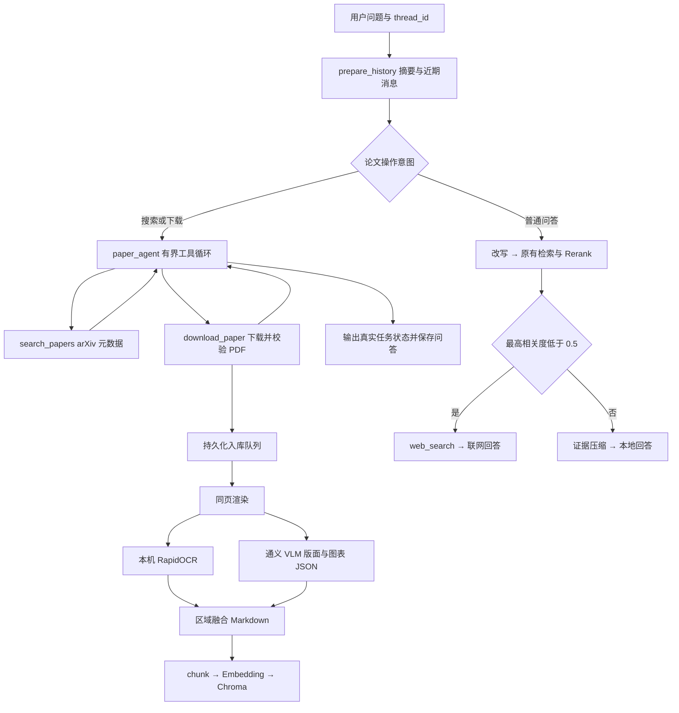

# PaperAgent 长对话、论文工具与双路解析

本文对应本次代码，阅读顺序建议为使用方法、流程、文件职责、调试实验。

## 使用方法

在项目虚拟环境运行 `python main.py --port 8000`，打开 http://127.0.0.1:8000 。在当前会话选择目标知识库后，可以依次输入下面的消息。

1. `帮我搜索论文 retrieval augmented generation，返回 3 篇`
2. `下载刚才第一篇并入库`
3. 等文档任务 completed 后，提问论文的研究方法与实验结论。

也可以直接输入 `下载 1706.03762 并入库`。论文来源目前选择 arXiv 开放论文，工具只接受真实 arXiv ID。网页上传支持一次选择多个 PDF，默认方案 3。

每轮最多执行 6 次论文工具调用，单次搜索默认 5 篇、上限 10 篇。搜索本身只返回元数据。用户提出下载或入库请求时，模型才获得下载工具。

下载工具会等待入库任务最多 60 秒，仍在排队或运行时返回 task_id 和当前状态，后台队列继续工作。通过界面的文档任务或 `GET /tasks/{task_id}` 查看进度。只有 completed 且 ingested=true 表示完成。failed 的 error 用于定位原因，原上传任务重试流程可继续使用。一次下载多篇时，HTTP 客户端需给予足够超时时间。

如果会话限定了若干文档，新下载论文仍进入当前 Collection。后续提问时将该论文加入文档范围，或选择整个知识库。

## 图和数据流



论文动作在检索前路由，避免用户要求下载论文时被当作知识库问题。摘要和近期消息用于理解“刚才第一篇”等指代，最新搜索目录另外保存在同一线程的 Checkpointer 中。工具调用遵循 AIMessage.tool_calls 与 ToolMessage.tool_call_id 配对，整轮完成后保存用户问答。

## 长上下文机制

完整成功问答保存在 Checkpointer 与业务库，模型每轮接收旧历史的增量摘要、最多最近 3 轮完整问答和本轮问题。近期消息超出历史预算时，更早进入摘要。摘要保留论文 ID、用户约束、必要数值、待办事项及不确定性。

普通 RAG 还会去除证据重复片段并选择与问题相关的完整句子。论文工具流程则缩短摘要与搜索结果，保留论文 ID、链接和任务状态。预算涵盖系统提示、问题、历史、工具定义和工具协议消息。无法装入时返回明确错误。

在 `.env` 中可调整下列默认值，修改后重启服务。

| 环境变量 | 默认值 | 职责 |
|---|---|---|
| PAPERAGENT_CONTEXT_INPUT_TOKENS | 16000 | 完整模型输入的保守预算 |
| PAPERAGENT_CONTEXT_OUTPUT_TOKENS | 2048 | 答案输出上限 |
| PAPERAGENT_HISTORY_TOKENS | 4000 | 摘要和近期消息预算 |
| PAPERAGENT_SUMMARY_TOKENS | 1200 | 摘要正文预算 |
| PAPERAGENT_EVIDENCE_TOKENS | 8000 | 普通 RAG 证据预算 |
| PAPERAGENT_RECENT_TURNS | 3 | 近期完整轮次上限 |

输入预算单位按 UTF-8 字节保守估算。实验中的真实 Token 与费用应使用 API usage_metadata。更换模型时要核对输入预算与输出上限之和是否适合模型窗口。

## OCR 与 VLM 如何合作

方案 1 使用 PDF 文本层，方案 2 使用本机 RapidOCR，方案 3 同时使用本机 OCR 与通义 VLM。论文工具固定提交方案 3，网页仍能选择三个方案做实验。

RapidOCR 3.10 使用安装包自带 PP-OCRv6 small 检测与识别模型，由 ONNX Runtime 在 CPU 执行。选择它是因为当前 Python 3.14 环境有兼容包，支持中英文识别且模型较小。PaddleOCR 可提供更多版面模型，部署依赖与资源需求需要单独验证。Tesseract 可作为纯本地对比，复杂双栏及图表需要补充结构处理。MinerU 可作为文档结构质量的实验参照。

OCR 和 VLM 接收相同 PNG。OCR 提供文字、置信度和像素框，VLM 提供阅读顺序、区域框、Markdown 表格、LaTeX 公式及图像描述。正文优先使用 OCR，图表保留 VLM 内容及局部 OCR 文本用于核对。每条 OCR 文字仅分配一次，无法匹配的文字保留并计数。模型错误、截断或无效 JSON 会使页面失败，未完成文档进入失败状态，阻止本次 Embedding。

`PAPERAGENT_OCR_THREADS=2` 控制本地推理线程。`PAPERAGENT_OCR_MIN_CONFIDENCE=0.5` 控制 OCR 最低置信度。`PAPERAGENT_OCR_MATCH_THRESHOLD=0.5` 控制文字框归属区域的最低覆盖比例。这两个 0.5 与检索 Rerank 阈值分别独立。

OCR 使用本地算力，方案 3 每个非空页调用 VLM，完整入库调用原有 Embedding 服务。选择该方案时应测量逐页延迟与 VLM 用量。页面产物位于原入库缓存目录的 `rendered/`、`ocr/`、`vlm/`，保留原始响应便于人工阅读。

## 文件职责与阅读顺序

| 文件 | 本次职责 |
|---|---|
| pdfprocess/context_compression.py | 历史摘要、近期消息选择、证据压缩和环境预算 |
| pdfprocess/rag.py | 组装图，在 prepare_history 后选择论文工具或原 RAG 分支 |
| pdfprocess/rag_state.py | 保存线程独立的 paper_catalog |
| pdfprocess/tools/papers.py | arXiv Atom 检索、受限流式下载、复用入库队列 |
| pdfprocess/tools/paper_agent.py | 模型工具循环、调用上限、输入预算、真实状态输出 |
| pdfprocess/tools/defaults.py | 注册默认论文搜索工具 |
| pdfprocess/tools/registry.py | 复制工具注册表供会话绑定下载目标 |
| upload_service/chat.py | 为会话绑定知识库、模型与下载工具，恢复论文目录 |
| upload_service/ingestion.py | 支持明确指定 Collection，复用原文件校验与任务去重 |
| upload_service/app.py | 先组装入库服务，再将依赖传给问答服务 |
| upload_service/config.py | 从环境读取 OCR 与 VLM 配置 |
| upload_service/benchmark_chat.py | 将论文工具模型用量计入实验总量 |
| pdfprocess/local_ocr.py | 本地模型懒加载、线程锁、文字框校验 |
| pdfprocess/pdf_fusion.py | 版面 JSON 校验与 OCR/VLM 区域融合 |
| pdfprocess/pdf_vision.py | 页面渲染、双路并发、原始结果与指标 |
| pdfprocess/ingest_common.py | OCR 参数校验、缓存指纹升级、指标，复用 chunk 与入库 |
| pdfprocess/pdf_pipeline2.py、pdf_pipeline3.py | 保留相同函数接口，更新两套解析实现 |
| pdfprocess/pdfload.py | 默认方案 3 的统一 PDF CLI |
| pdfprocess/compare_ingest.py | 三方案对比入口及本地模型参数提示 |
| web/index.html、web/app.js | 更新方案和论文来源显示文案 |
| requirements-ingest.txt、.env.example | 本地 OCR 依赖与可调整参数 |
| tests/test_pdf_ingestion.py | 原解析集成用例适配新双路契约 |
| tests/test_local_ocr_dual.py | 真实本地 OCR、并发、融合和失败重试 |
| tests/test_paper_tools.py | 下载边界、工具协议、预算和调用上限 |
| tests/test_paper_service.py | 真实 HTTP/队列/Chroma 链路、会话与重启测试 |

README 与原技术指南同步当前方案，本文补充本次变更的完整阅读入口。

## 手动调试和量化实验

准备 10～20 篇论文，覆盖英文、中文、双栏、扫描页、表格和公式。固定模型、DPI、chunk 参数和 Embedding，先挑每类 5 页人工转录或标注区域。按相同论文运行三个方案。

```powershell
python -m pdfprocess.compare_ingest --pdfs sample.pdf --schemes 1 2 3 --parse-only --refresh --output ./experiment/parse.json
```

`--refresh` 用于测实际解析耗时，缓存实验单独移除此参数。完整入库实验移除 `--parse-only`，记录报告中的 Collection，随后用原 `compare_retrieval` 对同一问题集评估。解析器改变后 chunk ID 可能变化，需基于新语料重新核对证据标注。

| 目标 | 计算方法与操作 |
|---|---|
| 文字准确率 | CER = 字符级编辑距离 / 人工参考字符数，按页面和类别汇总 |
| 表格质量 | 人工标注单元格，统计表头、数值、单位全部正确的单元格比例 |
| 公式质量 | 对人工 LaTeX 统一空白后计算精确匹配比例，另人工核查语义 |
| 融合质量 | 查看 unmatched_ocr_lines / ocr_line_count，并检查双栏顺序和重复内容 |
| 解析性能 | 从报告读取 local_ocr_seconds、vlm_seconds、dual_page_seconds、总耗时和调用数，区分冷启动与热运行 |
| 入库可用率 | 在规定时间内 completed 的任务数 / 下载提交成功的任务数，逐项检查失败原因 |
| 检索效果 | 对人工问题与证据标注计算 Recall@K、MRR、nDCG，使用原评测入口 |
| 对话压缩质量 | 构造 20～30 轮场景，埋入论文 ID、数值和否定条件，后续追问并人工计分 |
| 压缩收益 | 同一轮的历史原文估算量与 model_history 估算量比较，缩减率 = 1 - 压缩后 / 压缩前 |
| 实际成本 | 汇总 summary_usage、paper_agent_usage、rewrite_usage、generation_usage 等 API Token，与服务账单核对 |

对话实验可用原 `python -m upload_service.benchmark_chat --help`。固定同一场景，在不同 recent_turns 和 history_tokens 下创建新会话，记录成功率、端到端 P50/P95、实际输入 Token 和追问正确率。使用人工整理的全历史答案作为质量参照。摘要较短通常降低输入量，但需要测试用户约束的保留率。

在 `paper_agent.py` 的 registry.invoke 前后设置断点可检查工具参数、原始结果和 ToolMessage。在 `pdf_fusion.py` 的 fuse_page 设置断点可检查区域归属。在 `context_compression.py` 的 summarize_history 检查 boundary、summary_covered 与 model_history，可观察增量摘要范围。

## 测试边界

集成测试使用真实 FastAPI、SQLite、队列、PDF 渲染与 Chroma，DeepSeek SDK 经 httpx.MockTransport 返回受控响应。VLM 与 Embedding 使用测试替身。真实本机 OCR 已另行执行。2026 年 11 月 17 日的公开 arXiv 测试成功搜索到 Attention Is All You Need，并下载到有效的 15 页 PDF，大小 2,215,244 字节。真实云模型识别质量、摘要保真度与实际费用需要上述人工实验获得。
