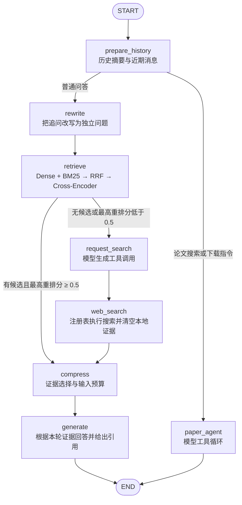
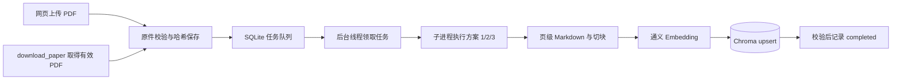

# PaperAgent：基础 RAG 与 LangGraph Agent 实验项目

PaperAgent 面向论文研读，把 **PDF 上传 → 多种解析 → Markdown 切块 → Embedding → Chroma → 多路召回 → 重排 → 多轮回答** 连起来，通过工具注册表学习网页搜索、校园论文搜索和自动入库。

这是一个侧重流程清晰、代码可读和方案对比的基础项目。解析质量、召回提升和答案质量需要你用论文标注集测量，项目没有预设的性能提升百分比。

## 涵盖哪些基础技术

| 环节 | 实现 | 可以研究的问题 |
| --- | --- | --- |
| 文件服务 | FastAPI 批量上传、PDF 校验、哈希原件、后台任务 | 上传接收时间与入库完成时间的区别 |
| PDF 多方案 | ① PyMuPDF Markdown；② 本地 RapidOCR；③ 本地 OCR + 通义 VLM 双路融合 | 文本层、扫描页、表格和公式的处理差异 |
| 切块与向量 | 页级 Markdown 标题与字符切块、通义 Embedding、Chroma | 块大小和重叠怎样影响正确证据 |
| 多路召回 | Dense、BM25、RRF 混合、混合 + ONNX Cross-Encoder | 关键词补召回和重排各自解决什么问题 |
| 多轮状态 | LangGraph State、SQLite Checkpointer、thread_id 隔离 | 会话如何恢复、摘要如何更新 |
| 工具使用 | 注册表、模型 tool_calls、ToolMessage、有界执行 | 模型选择工具与 Python 执行工具的分工 |
| 证据回查 | Chunk ID、页码、PDF 原件和来源快照 | 答案有没有可核对的依据 |
| 校园论文 | 万方原生检索、知网官网页面定位、权限约束下的 PDF 下载与入队 | 搜到论文、取得全文、入库完成的区别 |
| 服务部署 | 同源网页、SQLite 队列、单服务进程、Docker 配置 | 如何在校园网分享服务链接 |

三套解析保留相同函数约定：`ingest_pdf1/2/3`、`ingest_pdfs1/2/3`、`batch_upload_pdfs1/2/3`。默认上传使用方案 3，不向 MinerU 上传 PDF。OCR 在本地 CPU 运行，方案 3 的页图会发往已配置的通义视觉接口。

## 本地启动与使用

在项目根目录打开 PowerShell。桌面现有项目继续使用原 `.venv` 和 `.env`，无需覆盖。新安装使用 Python 3.14（当前验证环境）：

```powershell
python -m venv .venv
Copy-Item .env.example .env
.\.venv\Scripts\python.exe -m pip install -r requirements.txt
```

填写 `.env` 中的 `DASHSCOPE_API_KEY` 和 `DEEPSEEK_API`，然后执行：

```powershell
.\.venv\Scripts\python.exe main.py
```

打开 [研读页面](http://127.0.0.1:8000)、[API 调试页](http://127.0.0.1:8000/docs)、[技术说明页](http://127.0.0.1:8000/guide)。默认主模型 `deepseek-chat`、视觉模型 `qwen3-vl-flash`。

1. 文档库多选 PDF，选择方案，等待“已入库”。
2. 选择 `paper_chunks1/2/3` 知识库、检索方式和论文范围；旧 `paper_chunks` 继续可用。
3. 新建会话，提问、追问、点击引用核对原文和页码。
4. 查看检索与耗时，比较各阶段分数和模型用量。
5. 可输入“搜索万方关于知识图谱的论文”“下载上一轮第一篇论文并入库”。

重排模型首次运行会下载固定版本权重。默认缓存目录为 `pdfprocess/data/models/mmarco-minilm`，可设置 `PAPERAGENT_RERANKER_MODEL_DIR`。相关目录和预算见 `.env.example`。

## LangGraph 的实际流程

网页默认启用历史压缩、问题改写、混合重排及论文工具，共 **8 个业务节点、11 条连接**（含 START/END 连接）。关闭改写或更换检索模式后，`build_graph()` 会省略对应节点或分支。



`route_request()` 根据本轮操作意图选择论文工具或普通 RAG；`route_evidence()` 读取 retrieve 已计算的 `evidence_origin`。阈值为 `sigmoid(Cross-Encoder logit)`，不是向量余弦相似度，也不是校准后的正确率。恰好 0.5 使用本地路线，只有 `hybrid_rerank` 模式执行这个阈值判断。

联网分支丢弃本轮本地 context/sources，生成模型只接收独立问题与本轮网页工具证据，排除本地历史和摘要。回答附带“本地数据库未检索到足够相关的内容。”。Bing RSS 提供标题、链接和摘要，当前没有网页正文爬取；搜索失败会报告，空结果提示资料不足。

`paper_agent` 是一个图节点，内部由模型调用 `search_papers` / `download_paper`，注册表校验并执行，返回关联 `tool_call_id` 的 `ToolMessage`，模型再组织答案。每轮最多 6 次工具调用；工具循环没有画成不存在的 LangGraph 节点。



上传入库队列独立于问答图。下载工具最多等 60 秒，再按真实状态返回 queued/running/completed/failed，排队不等于入库完成。

| State 字段 | 职责 |
| --- | --- |
| question / retrieval_query | 用户原问题和独立检索问题 |
| messages | add_messages 按消息 ID 追加/替换完整历史 |
| conversation_summary / summary_covered / summary_fingerprint | 增量摘要、覆盖范围和一致性校验 |
| model_history | 本轮模型读取的近期历史视图 |
| context / sources / answer | 本轮证据、引用与答案 |
| evidence_origin / search_call | local/web/papers 路线与网页工具调用 |
| paper_catalog | 最近论文目录，支持“下载第一篇” |
| turn_id / metrics | 轮次身份、时延、分数、用量与工具记录 |

网页 session ID 就是 Checkpointer 的 thread_id。SQLite Checkpointer 跨重启恢复图状态；CLI 默认 InMemorySaver 仅在当前进程保留。完整消息不会被摘要删除，压缩只改变模型输入视图。

## 知网与万方：接入方式与实测边界

- 万方：使用官网 gRPC-Web 原生元数据检索，协议集中在 `wanfang_protocol.py`。
- 知网：使用 Bing 索引定位知网官方论文详情页，并校验域名和路径；当前没有接通知网原生检索 API。
- 下载：使用官方详情 URL 作为 paper_id，从官方页面及全文入口尝试取得 PDF；只接受同来源跳转，有效 PDF 才能入队。
- 仅提供 CAJ、出现验证码、机构授权不足或返回 HTML 时明确报错，没有 CAJ 转 PDF 功能。论文工具不使用 arXiv。

**2026-11-19 实测：** 万方原生检索成功返回元数据；本机后端机构检查未识别到机构，全文返回 401。知网后端请求出现安全验证；用户已在浏览器完成验证，但后端独立 HTTP 会话的全文权限仍未证明可用。两个站点的真实 PDF 自动下载仍需在授权可用的服务网络验证。浏览器权限不自动共享给 Python 或 Docker，项目不读取浏览器 Cookie。

## 校园网 Docker 部署

已提供 Dockerfile、compose.yaml、.dockerignore。当前电脑未检测到 Docker CLI/Desktop，容器构建运行尚未实测。

安装并启动 Docker Desktop（Linux containers / WSL2），填写 `.env`。本地服务占用 8000 时在 `.env` 设置 `PAPERAGENT_PORT=8001`：

```powershell
docker compose config --quiet
docker compose up -d --build
docker compose ps
docker compose logs -f --tail=100 paperagent
```

本机访问 `http://127.0.0.1:8001`；同学访问 `http://你的校园网IPv4:8001`，默认端口则为 8000。用 `ipconfig` 查校园网适配器地址。防火墙、校园无线客户端隔离和网络策略会影响连通性，电脑需要保持运行。

数据写入 `paperagent-data` 命名卷；镜像不打包 `.env`、个人 PDF、旧库或本地模型。容器采用新的数据空间，推荐重新上传论文，避免直接迁移 Windows SQLite 中的绝对路径。`docker compose down` 保留卷，**down -v 会删除卷内全部数据**。

当前为共享研读空间：图状态按会话隔离，文档和会话列表共用，没有个人账号与权限隔离。同学使用主机配置的 API 密钥，会产生模型调用费用。维持一个 Uvicorn 服务进程。

详见 [校园网部署指南](docs/DEPLOYMENT_GUIDE.md)。

## 目录与代码阅读

- `main.py`：服务入口；`upload_service/`：HTTP、原件、队列、文档、会话和数据库。
- `pdfprocess/paths.py`、`ingest_config.py`、`pipelines.py`：统一路径、配置和三方案分发。
- `pdf_pipeline1/2/3.py`：可对比入口；`pdf_vision.py`、`local_ocr.py`、`pdf_fusion.py`：页解析与融合。
- `ingest_common.py`、`paper_chunk.py`、`vector_store.py`：解析后处理、切块及入库。
- `retrieval.py`、`cross_encoder.py`：召回与重排。
- `rag_state.py → rag.py → rag_nodes.py`：建议的问答阅读顺序，提示词见 rag_prompts.py。
- `tools/`：注册表、网页工具、校园论文适配和模型工具循环。
- `web/`：HTML/CSS/JavaScript；`docs/`：技术说明；`tests/`：测试。

规范检索 CLI 为 `python -m pdfprocess.retrieval_cli`，旧拼写 retreiver.py 保留兼容。本次清理无关 day1 练习、历史 ZIP 示例、保存的终端帮助和重复演示入口；三套解析、实验脚本、原始 PDF、数据库与历史业务记录保留。

## 测试与真实效果实验

```powershell
.\.venv\Scripts\python.exe -B -m unittest discover -s tests -v
.\.venv\Scripts\python.exe -m pip check
.\.venv\Scripts\python.exe -m pdfprocess.compare_retrieval --collection paper_chunks --export-corpus experiments/corpus.json
.\.venv\Scripts\python.exe -m pdfprocess.compare_retrieval --collection paper_chunks --dataset experiments/retrieval_eval.json --dense-k 20 --keyword-k 20 --at-k 5 10 20 --output experiments/retrieval_result.json
```

先导出真实 Chunk，再标注“问题 → 所有正确证据 ID”。**同 K 比较算法，同算法比较 K**，同时观察候选召回率、Recall@K、MRR 和延迟。重排不能找回未进入候选池的证据。相对提升为 `(新 Recall - 原 Recall) / 原 Recall`，原值为 0 时相对提升无定义。语料变化后重新核对标注。

自动测试使用真实 SQLite/Chroma、受控模型及网络响应，并覆盖本地 ONNX 重排；通过测试不等于证明云模型质量或校园全文权限。

| 文档 | 内容 |
| --- | --- |
| [项目技术说明](docs/PROJECT_TECHNICAL_GUIDE.md) | 架构、技术备选、指标与调试 |
| [后端阅读指南](docs/BACKEND_REFACTOR_GUIDE.md) | 模块职责、断点和评测准备 |
| [PDF 三方案比较](docs/INGEST_COMPARISON.md) | 解析入口、产物和质量实验 |
| [检索比较](docs/RETRIEVAL_COMPARISON.md) | 多路召回、重排和人工标注 |
| [上传服务](docs/UPLOAD_SERVICE_GUIDE.md) | 接口、队列和性能实验 |
| [上下文压缩](docs/CONTEXT_COMPRESSION_GUIDE.md) | 增量摘要和证据预算 |
| [工具注册表](docs/TOOL_REGISTRY_GUIDE.md) | 工具扩展与调用协议 |
| [校园论文工具](docs/PAPER_TOOLS_GUIDE.md) | 知网/万方接入、权限和自动入库 |
| [校园网部署](docs/DEPLOYMENT_GUIDE.md) | Docker、存储和分享链接 |
