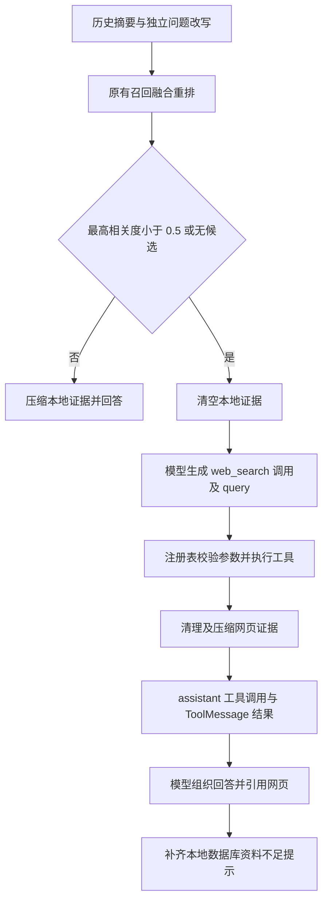

# PaperAgent 工具注册表与模型搜索调用

## 1. 本次接入的流程

默认混合重排模式继续计算本轮候选的最高 `rerank_relevance`。它由 Cross-Encoder 原始 logit 经过数值稳定的 sigmoid 得到。最高分严格低于 0.5，或本地没有候选时，进入模型搜索分支。分数等于 0.5 时继续本地回答。



搜索回答固定带有“本地数据库未检索到足够相关的内容。”。后续内容由模型根据当前网页证据组织，引用编号对应本轮网页。搜索没有结果时给出固定的资料不足反馈，搜索失败或模型调用格式异常时返回可重试错误。

表述使用“未检索到足够相关的内容”，对应当前检索范围、候选数和路由阈值。0.5 继续采用本次需求指定的数值，实际路由质量可用论文证据标注集校准。

## 2. 文件职责与阅读顺序

以下路径相对于桌面 `langgraph` 项目目录。

| 文件 | 职责与建议阅读位置 |
| --- | --- |
| `pdfprocess/tools/registry.py` | `ToolSpec` 保存登记信息，`ToolResult` 统一执行结果，`ToolRegistry` 提供登记、发现和调用 |
| `pdfprocess/tools/defaults.py` | `create_default_registry()` 显式登记默认工具，兼容原来的搜索替身注入接口 |
| `pdfprocess/tools/search_flow.py` | 工具调用提示词、网页回答提示词、模型请求校验及 `ToolMessage` 构造 |
| `pdfprocess/tools/__init__.py` | 导出注册表公共类型 |
| `pdfprocess/rag.py` | 连接 `request_search → web_search → compress → generate`，保持检索路由及来源隔离 |
| `pdfprocess/rag_nodes.py` | 执行网页工具结果整理、证据预算与答案生成 |
| `upload_service/chat.py` | 服务启动时创建目录，向真实模型绑定搜索工具，并将调用链注入每个会话 |
| `pdfprocess/context_compression.py` | 输入估算加入工具调用参数、调用 ID 和工具消息名称，增加工具请求预算 |
| `upload_service/benchmark_chat.py` | 将生成工具调用所用的模型 Token 纳入已有实验报告 |
| `tests/test_tool_registry.py` | 注册表规则和执行边界测试 |
| `tests/test_agent_search.py` | 低分路由、工具协议、预算、失败重试和历史隔离测试 |
| `tests/test_tool_calling_service.py` | 实际 HTTP 服务入口与 DeepSeek SDK 请求结构测试 |

实现沿用当前同步 FastAPI 服务和同步工具调用。注册表保存在进程内，检查点保存本轮调用消息、证据和可序列化的执行记录。新增代码的主要逻辑块与复杂计算旁均有中文注释。

## 3. 为什么选择 BaseTool 注册表

现有 `web_search` 使用 LangChain `@tool`，已经具有名称、说明和参数 Schema。注册表直接复用这些信息，并补充 `enabled` 和 `tags`。名称重复时在注册阶段报错。

普通函数字典的实现更短，但需要自行维护参数结构及模型工具定义。当前方案复用 LangChain 校验和 `bind_tools`，适合已有项目。MCP 适合跨进程共享能力，同时增加服务、连接及生命周期管理。

目录在服务启动时创建，更新工具登记后重启服务即可生效。模型实例与工具对象通过依赖注入复用，工具执行时释放目录锁，使不同会话能够独立运行耗时调用。

## 4. 如何添加新工具

例如新增一个标题空白整理工具。将下面函数放入新工具模块。

```python
from langchain_core.tools import tool


@tool
def normalize_title(title: str) -> str:
    """归一化论文标题中的连续空白，保留原始文字。"""
    return " ".join(title.split())
```

然后在 `create_default_registry()` 内导入并登记。

```python
registry.register(normalize_title, tags=("text", "paper"))
```

登记后可以查看 Schema 并手动调用。

```python
registry.describe("normalize_title")
registry.list_tools(enabled_only=True, tag="text")
result = registry.invoke("normalize_title", {"title": "Attention   Is All You Need"})
print(result.success, result.data, result.elapsed_seconds)
```

示例工具仅用于说明扩展方式，本次默认目录登记现有的 `web_search`。

让模型使用新增能力时，在对应工作流节点中通过 `get_langchain_tools(names=(...))` 选择要绑定的工具，并设计该节点的结果处理。当前搜索节点只绑定 `web_search`，低分后由模型组织搜索词，并使用 `tool_choice="web_search"` 要求它产生搜索调用。本轮最多执行一次模型搜索调用，随后进入答案生成。

## 5. 参数与执行结果

注册表调用入口接收名称和参数字典。输入按工具的参数 Schema 校验，多余字段主动报告。执行结果通过 `ToolResult` 返回。

```python
result = registry.invoke("web_search", {"query": "LangGraph checkpoint persistence"})

if result.success:
    print(result.data)
else:
    print(result.error.code, result.error.message)
```

| 字段 | 含义 |
| --- | --- |
| `tool_name` | 工具唯一名称 |
| `success` | 工具是否成功返回可序列化数据 |
| `data` | 工具原有数据结构，例如网页列表 |
| `error.code` | `unavailable`、`invalid_arguments` 或 `execution_failed` |
| `error.message` | 便于定位问题的简短原因 |
| `elapsed_seconds` | 参数处理与执行总耗时 |

工具输出需要转换为 JSON 可表示的值，方便写入检查点和通过 HTTP 返回。超时由 HTTP/SDK 客户端设置，重试由具体工具控制。现有 Bing 工具继续使用超时、响应大小限制及一次临时故障重试。

## 6. 模型工具调用协议

模型第一阶段只收到独立问题、固定任务说明和搜索工具 Schema。返回一个 `AIMessage.tool_calls`，其中包含工具名称、`query` 参数和调用 ID。

工作流校验工具名称、调用数量、ID、参数和查询长度。模型直接返回答案、返回其他工具名或缺少参数时，本轮报错并支持重试。

注册表执行成功后，网页资料进入现有清理和压缩流程。最终模型输入的角色顺序为以下结构。

```text
system       当前回答规则和本地数据库资料不足提示
human        本轮独立问题
assistant    已验证的 web_search 调用
tool         压缩后的网页证据，tool_call_id 匹配上面的调用 ID
```

最终答案阶段使用独立的网页回答提示词。程序再次检查返回值为非空文本，并补齐固定提示。完整会话仍保存成功的用户问题和答案消息对，工具协议消息单独作为本轮检查点状态保存。

## 7. 与会话和压缩的配合

- 联网分支的调用模型与答案模型均接收独立问题。本地候选、历史原文和历史摘要通过现有路由隔离。
- 问题改写阶段继续使用短历史消解指代，随后把独立问题交给工具调用模型。
- 最终 `ToolMessage` 使用压缩后的网页文本，来源编号与 `sources` 对齐。
- 完整答案输入预算包含系统提示、问题、assistant 工具调用、工具参数、调用 ID、工具名称及网页正文。
- `CompressionConfig.tool_input_tokens` 默认 6000，工具选择请求还会把工具 Schema 计入估算。工具调用模型输出上限为 512 Token。
- 新问题重置 `search_call`。既有 `thread_id` 隔离、SQLite 恢复和成功请求幂等继续复用。

原有开发接口可继续注入 `answer_chain` 和 `web_search_tool` 做直接调用实验。生产服务与默认 CLI 会创建模型工具调用链。注入原生调用链时同时提供 `tool_call_chain` 和 `web_answer_chain`。传入 `web_search_tool=None` 可用于本地基线实验。

## 8. 手动调试与指标

在网页设置选择“混合召回 + Cross-Encoder”，新建会话后提交一个本地知识库缺少的公开问题。打开答案中的检索与耗时面板，查看当前轮次 `metrics`。

| 观察项 | 字段或位置 |
| --- | --- |
| 路由是否满足条件 | `local_max_relevance < 0.5` 或 `web_fallback_reason=no_local_results` |
| 是否实际经过模型调用 | `tool_call_mode=model` |
| 模型生成的搜索词 | `web_search_query`、`tool_calls[].arguments.query` |
| 注册表执行记录 | `tool_calls[].tool_name`、`success`、`elapsed_seconds` |
| 调用工具的模型耗时 | `tool_selection_seconds` |
| 调用工具的模型实际用量 | `tool_selection_usage` |
| 生成答案的实际用量 | `generation_usage` |
| 输入预算 | `tool_selection_input_tokens_estimate`、`input_tokens_after_compression` |
| 来源是否来自网页 | `evidence_origin=web`、`sources[].kind=web` 及来源 URL |

建议断点依次设在 `request_search_node()`、`ToolRegistry.invoke()`、`web_search_node()`、`compress_node()` 和 `generate_node()`。观察模型返回的 `tool_calls`，核对实际执行的参数，并核对最终 `ToolMessage.tool_call_id`。

做效果对比时，固定问题集、知识库版本、重排模型和阈值，记录搜索问题相关性、引用正确率、答案正确率、总耗时和总费用。模型生成搜索词带来的质量变化需要人工标注评测。实际用量应合计摘要、改写、工具调用生成和答案生成四部分。现有基准工具已经加入 `tool_selection_usage` 汇总，失败调用和服务商内部重试的额外费用需结合调用日志与账单核对。

## 9. 自动验证范围

```powershell
.\.venv\Scripts\python.exe -B -m unittest discover -s tests -v
```

新增测试覆盖注册冲突、禁用工具、参数异常、JSON 输出、并发执行、阈值边界、无候选、工具调用格式异常、网页空结果、失败重试、预算、历史隔离、会话恢复和 Token 汇总。

服务接线测试使用真实 DeepSeek SDK，并通过 `httpx.MockTransport` 在进程内返回 API 响应，检查请求中的工具 Schema、`tool_choice` 和角色协议。搜索和 Embedding 使用测试替身。真实云端工具调用兼容性、答案质量和实际费用仍需在真实 API 实验中验证。


本地 OCR 双路解析、长对话预算与论文自动入库的当前实现及调试步骤见 [PAPER_TOOLS_GUIDE.md](PAPER_TOOLS_GUIDE.md)。
